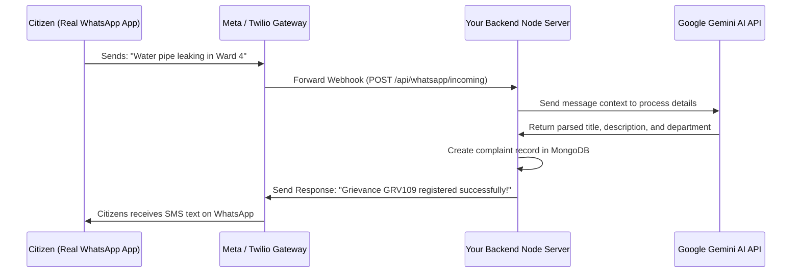

# Real-Time WhatsApp Business API Integration Guide

To connect your LokSeva Grievance System to a real WhatsApp number so citizens can register complaints and receive automatic status notifications in real time, you must integrate a WhatsApp Business API Gateway (like **Twilio** or the official **Meta Cloud API**).

This guide explains how to set up the integration using the **Twilio API for WhatsApp** (the industry-standard node integration).

---

## 1. System Architecture



---

## 2. Setting Up Twilio API for WhatsApp
1. Create a **[Twilio Account](https://www.twilio.com/)**.
2. Go to the Twilio Console and activate the **Twilio Sandbox for WhatsApp** (or register your official business profile to use a dedicated number).
3. Copy your API credentials:
   * `TWILIO_ACCOUNT_SID`
   * `TWILIO_AUTH_TOKEN`
   * `TWILIO_NUMBER` (e.g. `whatsapp:+14155238886`)

---

## 3. Implementation Steps & Code

### Step A: Install dependencies on your backend
In the `backend` folder, install the Twilio Node helper library:
```bash
npm install twilio
```

### Step B: Configure Backend Environment Variables (`.env`)
Add these credentials to your backend `.env` file:
```env
TWILIO_ACCOUNT_SID=your_twilio_sid
TWILIO_AUTH_TOKEN=your_twilio_auth_token
TWILIO_NUMBER=whatsapp:+14155238886
```

### Step C: Create the Webhook Controller (`whatsappController.js`)
Create a new file `backend/controllers/whatsappController.js` to process incoming messages from citizens:

```javascript
const twilio = require("twilio");
const Complaint = require("../models/Complaint");
const User = require("../models/User");
const { GoogleGenerativeAI } = require("@google/generative-ai");

const accountSid = process.env.TWILIO_ACCOUNT_SID;
const authToken = process.env.TWILIO_AUTH_TOKEN;
const client = twilio(accountSid, authToken);

// Handle incoming messages from WhatsApp
const handleIncomingWhatsApp = async (req, res) => {
  const { Body, From } = req.body; // Body = text, From = whatsapp:+919876543210
  const phone = From.replace("whatsapp:", "");

  try {
    // 1. Check if user exists by phone number, or find default admin for registration
    let user = await User.findOne({ phone });
    if (!user) {
      // Create a temporary profile for new users
      user = await User.create({
        name: "WhatsApp User",
        email: `${phone}@whatsapp.com`,
        phone,
        role: "citizen",
        password: "whatsapp_dummy_pwd"
      });
    }

    // 2. Parse the grievance using Gemini AI
    let replyMessage = "";
    const hasGeminiKey = process.env.GEMINI_API_KEY;

    if (hasGeminiKey) {
      const genAI = new GoogleGenerativeAI(process.env.GEMINI_API_KEY);
      const model = genAI.getGenerativeModel({ model: "gemini-1.5-flash" });

      const prompt = `
        You are a civic department router. Parse the following citizen message: "${Body}"
        Identify:
        - Title (Short title)
        - Description (Detailed text)
        - Department (Choose from: Water Supply Department, Electricity Department, Sanitation Department, Road and Transport Department)
        
        Return the result ONLY as a clean JSON object with keys: "title", "description", "department". Do not write any markdown or text.
      `;
      
      const aiResult = await model.generateContent(prompt);
      const data = JSON.parse(aiResult.response.text().trim());

      // 3. Create the Grievance in MongoDB
      const compId = `GRV${Date.now().toString().slice(-9)}`;
      const complaint = await Complaint.create({
        userId: user._id,
        complaintId: compId,
        title: data.title,
        description: data.description,
        department: data.department,
        status: "Pending",
        priority: "Medium",
        isDuplicate: false
      });

      replyMessage = `✅ Grievance Registered Successfully!\n\nReference ID: *${compId}*\nDepartment: *${data.department}*\nTitle: *${data.title}*\n\nTrack your complaint online at: https://yourportal.gov.in/track?id=${compId}`;
    } else {
      replyMessage = "Thank you for contacting LokSeva helpline. Gemini AI is offline. Please register manually.";
    }

    // 4. Send reply back to citizen via Twilio
    await client.messages.create({
      body: replyMessage,
      from: process.env.TWILIO_NUMBER,
      to: From
    });

    res.status(200).send("<Response></Response>");
  } catch (error) {
    console.error("WhatsApp error:", error);
    res.status(500).send("Error handling message");
  }
};

// Send outbound notification to citizen when status changes
const sendStatusNotification = async (phone, complaintId, oldStatus, newStatus) => {
  try {
    const text = `🔔 *LokSeva Update Notification*\n\nYour Grievance *${complaintId}* status has been updated from *${oldStatus}* to *${newStatus}*.\n\nReview updates at: https://yourportal.gov.in/track?id=${complaintId}`;
    
    await client.messages.create({
      body: text,
      from: process.env.TWILIO_NUMBER,
      to: `whatsapp:${phone}`
    });
    console.log(`Notification sent to ${phone} for ${complaintId}`);
  } catch (error) {
    console.error("Failed to send WhatsApp notification:", error.message);
  }
};

module.exports = {
  handleIncomingWhatsApp,
  sendStatusNotification
};
```

### Step D: Register Webhook Route in Backend (`server.js`)
Mount the Webhook route in your backend server file:

```javascript
const { handleIncomingWhatsApp } = require("./controllers/whatsappController");

// Twilio webhook must read urlencoded payloads
app.post(
  "/api/whatsapp/incoming", 
  express.urlencoded({ extended: false }), 
  handleIncomingWhatsApp
);
```

### Step E: Set webhook in Twilio Console
1. Expose your local port (e.g. `5000`) using a tunnel like **ngrok**:
   ```bash
   ngrok http 5000
   ```
2. Copy the secure HTTPS URL provided by ngrok (e.g. `https://abc4-56-78.ngrok-free.app`).
3. In the Twilio Console under **WhatsApp Sandbox Settings**, paste the URL into the **"A MESSAGE COMES IN"** Webhook URL field:
   `https://abc4-56-78.ngrok-free.app/api/whatsapp/incoming`
4. Click Save.

---

## 4. Triggering Outbound Notifications (Real-Time Updates)
To send automatic notifications when an officer changes the status:
1. Import `sendStatusNotification` inside your `adminController.js`.
2. Inside `updateStatus`, call the helper:
   ```javascript
   // After updating status in DB
   const user = await User.findById(complaint.userId);
   if (user && user.phone) {
     await sendStatusNotification(user.phone, complaint.complaintId, oldStatus, newStatus);
   }
   ```
